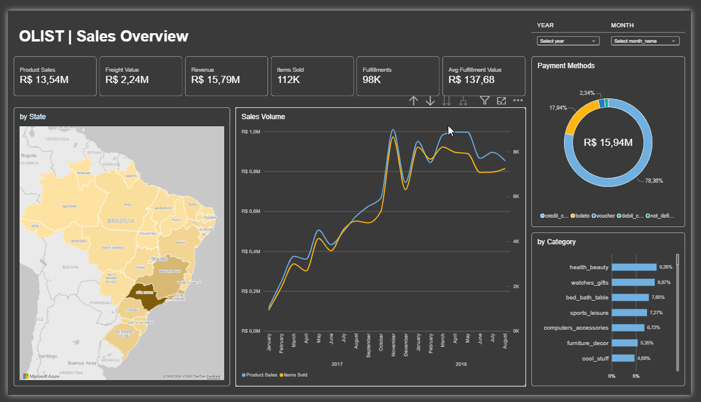
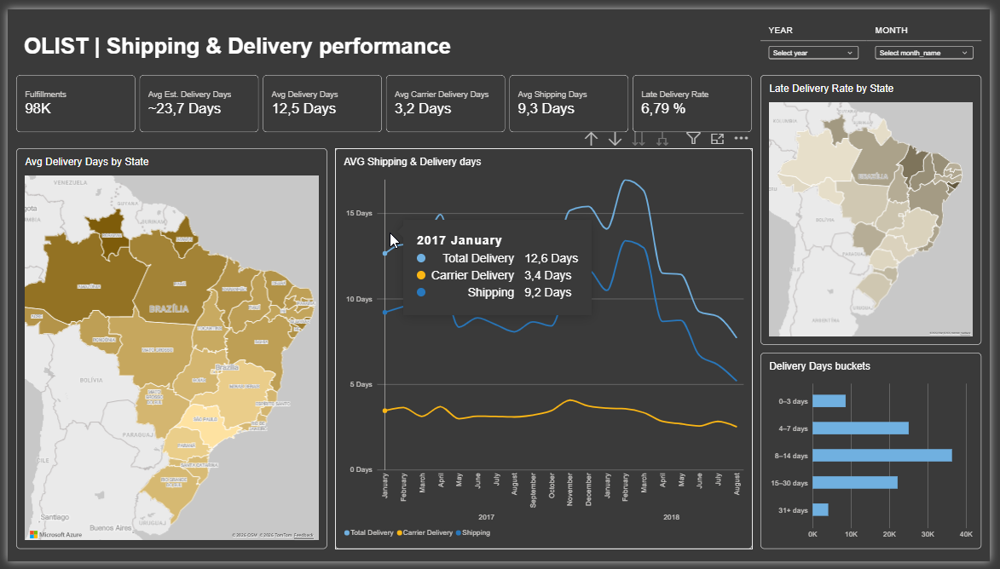
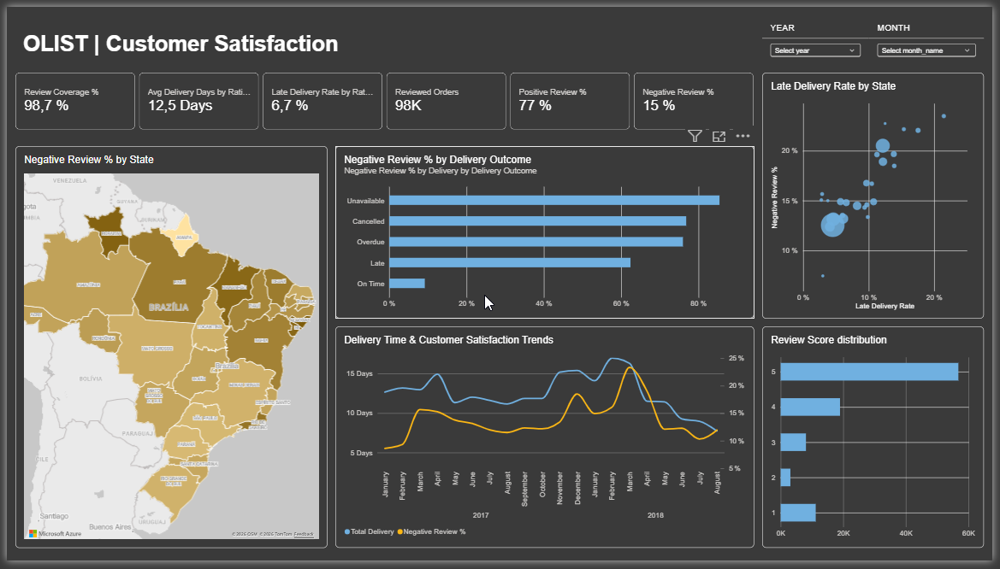

# Olist Analytics — Power BI Report

## Overview

An interactive Power BI report built on a SQL Server dimensional warehouse using the Brazilian Olist e-commerce dataset.

The report explores sales performance, order fulfillment, and customer satisfaction. It demonstrates dimensional modeling, reusable DAX measures, and interactive business reporting.

## Report Pages

### 1. Sales Overview

- Revenue, product sales, freight costs, and order volume
- Monthly sales trends
- Product category performance
- Geographic distribution of sales
- Payment method analysis

### 2. Shipping & DeliveryV

- Delivery durations and fulfillment performance
- Late delivery rates
- Regional delivery performance
- Comparison of estimated and actual delivery times

### 3. Customer Satisfaction

- Positive and negative review rates
- Review score distribution
- Satisfaction across Brazilian states
- Negative review rates by delivery outcome
- Relationship between delivery performance and customer feedback

## Semantic Model

The report uses a **fact constellation (galaxy) schema** with multiple fact tables sharing conformed dimensions.

**Fact tables**
- Orders
- Order Items
- Payments
- Reviews

**Shared dimensions**
- Date
- Customer
- Location
- Product
- Seller

Fact tables maintain separate grains to avoid incorrect aggregations. Relationships generally use single-direction filtering from dimensions to facts.

The semantic model uses:

- Explicit, reusable DAX measures
- `CALCULATE` for filter-context manipulation
- `TREATAS` for analyses requiring filters across otherwise disconnected fact tables
- A dedicated date dimension instead of Power BI's automatic date tables
- Display folders, hidden technical columns, and consistent measure formatting

## Row-Level Security

A demonstration `SouthEast` role restricts access to orders associated with four Brazilian states: SP, RJ, MG, and ES.

RLS is applied through the Location dimension and propagates to connected fact tables using existing relationships.

This is a local demonstration of regional data access, not a deployed user-permission system.

## Data Scope and Limitations

**Reporting period:** January 1, 2017 – August 31, 2018.

Periods outside this range are excluded from report analysis because of incomplete or sparse data coverage. Source records remain preserved in the warehouse.

**Delivery classification:** Orders are categorized as on-time, late, overdue, pending, cancelled, or unavailable. Overdue status uses a provisional observation date, not a verified data-extraction timestamp.

**Customer satisfaction:** Review scores of 1–2 are classified as negative, and 4–5 as positive. Review-level metrics count review records unless explicitly labeled as distinct reviewed orders.

Relationships between delivery performance and review scores represent observed associations, not proof of causation.

## Project Files

The report is stored in **Power BI Project (PBIP)** format, allowing semantic-model and report definitions to be version-controlled.

The semantic model uses TMDL, while the report definition uses PBIR.

## Opening the Report

1. Open the `.pbip` file using Power BI Desktop.
2. Configure access to the local SQL Server `EcommerceAnalytics` database.
3. Refresh the semantic model if required.
4. Explore the three report pages.

The source data, ETL pipeline, warehouse schema, and warehouse reconciliation are documented in the repository's main README.

## Model Quality

The semantic model was reviewed using Tabular Editor 2 and its Best Practice Analyzer (BPA). Relevant modeling, formatting, naming, and organizational findings were evaluated individually.

Automated semantic-model CI tests and cloud deployment are outside the scope of this version.